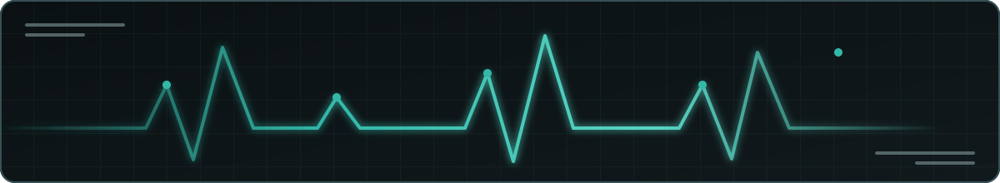

# Hey, I'm Leen 👋

<h2>Developer · Linux User · Open-Source Builder</h2>

<code>LEENIUM://PROFILE</code> ·
<code>DRESDEN</code> ·
<code>RUST</code> ·
<code>GO</code> ·
<code>LINUX</code>

<kbd><a href="https://github.com/drunkleen">GITHUB</a></kbd>
<kbd><a href="https://twitter.com/DrunkLeen">X</a></kbd>
<kbd><a href="https://www.instagram.com/drunkleen">INSTAGRAM</a></kbd>
<kbd><a href="https://drunkleen.com">BLOG</a></kbd>
<kbd><a href="mailto:anakin@drunkleen.com">EMAIL</a></kbd>

<pre>
╭─ LEENIUM // SYSTEM PROFILE ───────────────────────────────────────────────╮
│ USER      leen                         MODE      building                  │
│ LOCATION  Dresden, Germany             EDITOR    Neovim                    │
│ SYSTEM    Linux                        SHELL     terminal-first            │
│ FOCUS     tools · infrastructure · networking · security                  │
╰───────────────────────────────────────────────────────────────────────────╯
</pre>

## `01 // IDENTITY`

<table>
<tr>
<td width="50%" valign="top">
<h3>What I build</h3>

Practical open-source tools shaped by real daily use: fast terminal software,
self-hosted infrastructure, networking utilities, security experiments, and
systems that are useful before they are impressive.

</td>
<td width="50%" valign="top">
<h3>What I share</h3>

Technical notes and Persian educational content for developers who want to
understand how software, Linux, networks, and low-level systems actually work.

</td>
</tr>
</table>

## `02 // TOOLCHAIN`

<kbd>Rust</kbd>
<kbd>Go</kbd>
<kbd>Linux</kbd>
<kbd>Docker</kbd>
<kbd>Kubernetes</kbd>
<kbd>Git</kbd>
<kbd>Neovim</kbd>
<kbd>PostgreSQL</kbd>
<kbd>SQLite</kbd>
<kbd>Bash</kbd>
<kbd>Python</kbd>
<kbd>Java</kbd>

<pre>
leen@galaxy:~$ toolchain --status
[ready] systems programming     Rust · Go
[ready] infrastructure          Linux · Docker · Kubernetes
[ready] data                    PostgreSQL · SQLite
[ready] workflow                Git · Neovim · Bash
</pre>

## `03 // FEATURED PROJECTS`

<table>
<tr>
<td valign="top">
<h3>Leenium Theme</h3>

<code>THEME</code> <code>LINUX</code> <code>OMARCHY</code> <code>NEOVIM</code>

A cohesive dark-teal environment for Omarchy, terminals, Neovim, VS Code,
OpenCode, Waybar, browsers, btop, and the rest of the daily desktop.

<strong><a href="https://github.com/drunkleen/leenium.omarchy">VIEW REPOSITORY →</a></strong>
&nbsp;·&nbsp;
<strong><a href="https://leenium.drunkleen.com">OPEN PROJECT PAGE →</a></strong>

</td>
</tr>
</table>

 

<table>
<tr>
<td valign="top">
<h3>Leenfetch</h3>

<code>RUST</code> <code>CLI</code> <code>LINUX</code>

A fast, minimal system-information tool designed for clean terminal output,
small overhead, and actual everyday use.

<strong><a href="https://github.com/drunkleen/leenfetch">VIEW REPOSITORY →</a></strong>

</td>
</tr>
</table>

 

<table>
<tr>
<td valign="top">
<h3>Persian Rust</h3>

<code>RUST</code> <code>EDUCATION</code> <code>COMMUNITY</code>

Persian learning material, community resources, and open-source work for
people entering the Rust ecosystem.

<strong><a href="https://github.com/persian-rust">OPEN ORGANIZATION →</a></strong>

</td>
</tr>
</table>

## `04 // LIVE DEVELOPMENT SIGNAL`

<!--START_SECTION:waka-->

<h2>Development signal</h2>

<code>LEENIUM://TELEMETRY</code> · <strong>LAST 7 DAYS</strong> · WakaTime + GitHub

<small>Europe/Berlin · generated from live development activity</small>

<table><tr>
<td align="center"><strong>3 hrs 8 mins</strong> TOTAL DEV</td>
<td align="center"><strong>26 mins</strong> DAILY AVG</td>
<td align="center"><strong>Go</strong> TOP LANGUAGE</td>
<td align="center"><strong>Neovim</strong> EDITOR</td>
<td align="center"><strong>29</strong> COMMITS</td>
</tr></table>

<pre>
╭─ WAKATIME // 7 DAY SIGNAL ─────────────────────────────────────────────╮
│ TOTAL DEV   3 hrs 8 mins       DAILY AVG   26 mins          │
│ TOP LANGUAGE Go              78.14%     EDITOR      Neovim           │
│ SYSTEM       Linux            STATUS      TRACKING LIVE             │
├─────────────────────────────────────────────────────────────────────────┤
  LANGUAGES
    Go               ██████████████░░░░   78.14%  2 hrs 27 mins
    Lua              ███░░░░░░░░░░░░░░░   16.42%        30 mins
    Makefile         █░░░░░░░░░░░░░░░░░    5.34%        10 mins
    Git Config       ░░░░░░░░░░░░░░░░░░    0.07%         0 secs
    Other            ░░░░░░░░░░░░░░░░░░    0.04%         0 secs
│
  EDITORS
    Neovim           ██████████████████  100.00%   3 hrs 8 mins
│
  OPERATING SYSTEMS
    Linux            ██████████████████  100.00%   3 hrs 8 mins
╰─────────────────────────────────────────────────────────────────────────╯
</pre>

<strong>Open full telemetry</strong> · languages, environment, commit rhythm, repositories

<table>
<tr><th align="left" colspan="4">Programming languages</th></tr>
<tr><th align="left">Name</th><th align="left">Time</th><th align="left">Activity</th><th align="right">Share</th></tr>
<tr><td>Go</td><td><code>2 hrs 27 mins</code></td><td><code>█████████████░░░</code></td><td align="right">78.14%</td></tr>
<tr><td>Lua</td><td><code>30 mins</code></td><td><code>███░░░░░░░░░░░░░</code></td><td align="right">16.42%</td></tr>
<tr><td>Makefile</td><td><code>10 mins</code></td><td><code>█░░░░░░░░░░░░░░░</code></td><td align="right">5.34%</td></tr>
<tr><td>Git Config</td><td><code>0 secs</code></td><td><code>░░░░░░░░░░░░░░░░</code></td><td align="right">0.07%</td></tr>
<tr><td>Other</td><td><code>0 secs</code></td><td><code>░░░░░░░░░░░░░░░░</code></td><td align="right">0.04%</td></tr>
</table>

<table>
<tr><th align="left" colspan="4">Editors</th></tr>
<tr><th align="left">Name</th><th align="left">Time</th><th align="left">Activity</th><th align="right">Share</th></tr>
<tr><td>Neovim</td><td><code>3 hrs 8 mins</code></td><td><code>████████████████</code></td><td align="right">100.00%</td></tr>
</table>

<table>
<tr><th align="left" colspan="4">Operating systems</th></tr>
<tr><th align="left">Name</th><th align="left">Time</th><th align="left">Activity</th><th align="right">Share</th></tr>
<tr><td>Linux</td><td><code>3 hrs 8 mins</code></td><td><code>████████████████</code></td><td align="right">100.00%</td></tr>
</table>

<table>
<tr><th align="left" colspan="3">Commit rhythm</th></tr>
<tr><th align="left">Period</th><th align="left">Activity</th><th align="right">Commits</th></tr>
<tr><td>Morning</td><td><code>██░░░░░░░░░░░░░░</code></td><td align="right">4</td></tr>
<tr><td>Daytime</td><td><code>██░░░░░░░░░░░░░░</code></td><td align="right">3</td></tr>
<tr><td>Evening</td><td><code>██████░░░░░░░░░░</code></td><td align="right">11</td></tr>
<tr><td>Night</td><td><code>██████░░░░░░░░░░</code></td><td align="right">11</td></tr>
</table>

<table>
<tr><th align="left" colspan="3">Repository languages</th></tr>
<tr><th align="left">Language</th><th align="left">Share</th><th align="right">Repositories</th></tr>
<tr><td>Go</td><td><code>███░░░░░░░░░░░░░</code></td><td align="right">11</td></tr>
<tr><td>Python</td><td><code>███░░░░░░░░░░░░░</code></td><td align="right">10</td></tr>
<tr><td>Rust</td><td><code>██░░░░░░░░░░░░░░</code></td><td align="right">9</td></tr>
<tr><td>Java</td><td><code>██░░░░░░░░░░░░░░</code></td><td align="right">6</td></tr>
<tr><td>Other</td><td><code>██░░░░░░░░░░░░░░</code></td><td align="right">6</td></tr>
</table>

<small>Last Updated on 13/11/2026 09:25:20 UTC</small>

<!--END_SECTION:waka-->

---

<code>LEENIUM.STATUS</code> · <code>ONLINE</code> · <code>MASTER</code>

<em>Build useful things. Publish what you learn. Keep the signal clean.</em>

<a href="https://drunkleen.com">Blog</a> ·
<a href="https://github.com/drunkleen">GitHub</a> ·
<a href="mailto:anakin@drunkleen.com">anakin@drunkleen.com</a>

