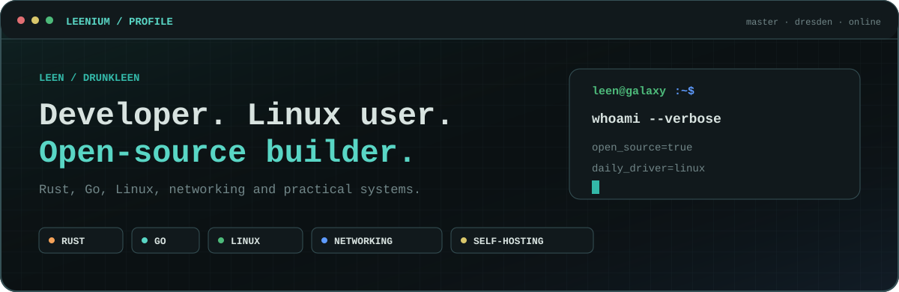
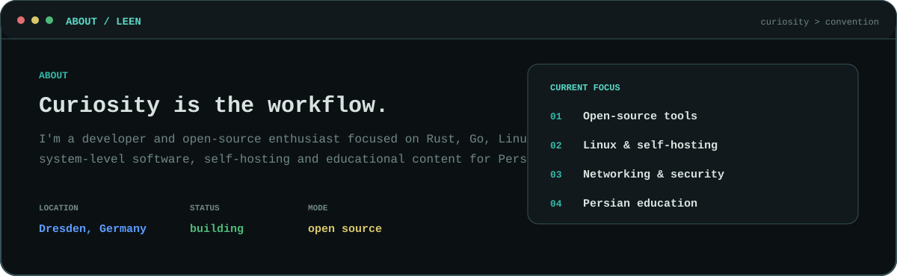
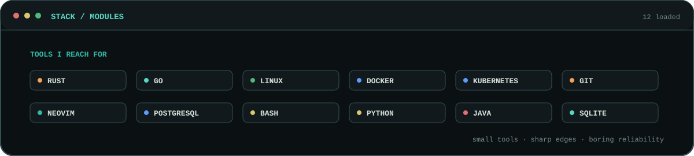
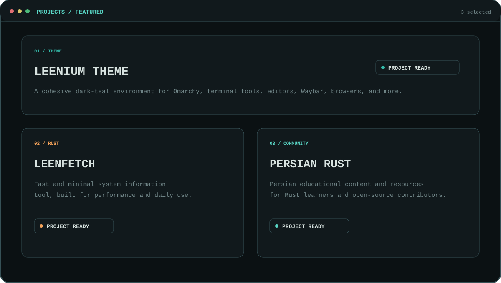
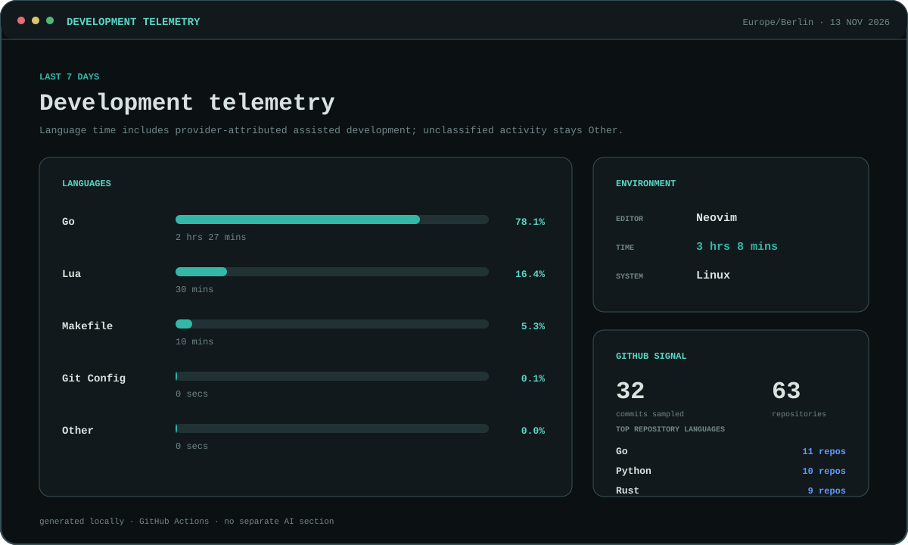
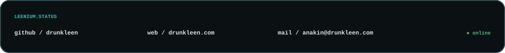

# Hey, I'm Leen 👋

<picture>
  <source media="(max-width: 600px)" srcset="./assets/leenium/hero-mobile.svg">
  
</picture>

 

  
  
  
  
  

<picture>
  <source media="(max-width: 600px)" srcset="./assets/leenium/about-mobile.svg">
  
</picture>

 

<picture>
  <source media="(max-width: 600px)" srcset="./assets/leenium/stack-mobile.svg">
  
</picture>

 

<picture>
  <source media="(max-width: 600px)" srcset="./assets/leenium/projects-mobile.svg">
  
</picture>

  
  

<!--START_SECTION:waka-->
<picture>
  <source media="(max-width: 600px)" srcset="./assets/leenium/development-metrics-mobile.svg">
  
</picture>
<!--END_SECTION:waka-->

 

<picture>
  <source media="(max-width: 600px)" srcset="./assets/leenium/footer-mobile.svg">
  
</picture>

